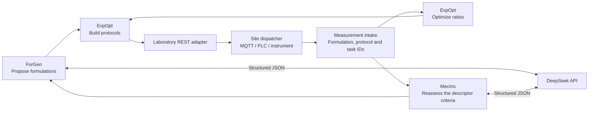

# Agent workflow and laboratory interface



[`coral/orchestrator.py`](../coral/orchestrator.py) coordinates both feedback loops. It stores agent decisions and evidence, generates protocols, and advances after the active batch has received its measurements. [`coral/llm.py`](../coral/llm.py) connects to DeepSeek Chat Completions. ForGen and MecIns validate the returned JSON before handing it to the next step.

ForGen combines retrieved literature passages with the archived molecular-group prior. The [clustering and mining commands](reproduction.md#hierarchical-clustering) show how descriptors and publication records are converted to group-level pair frequencies.

## Laboratory connection

1. ExpOpt generates an electrochemical protocol from the proposed formulation.
2. [`bind_protocol`](../coral/laboratory.py) inserts protocol settings into the facility bindings. [`submit_to_platform`](../coral/laboratory.py) sends `POST /api/v1/experiment-tasks`. The remote protocol for electrochemical testing specifies `deviceName=2`, `experimentName=204` and `experimentParams.info.testParam`. The platform generates the accepted `taskId`.
3. The deployment stores task JSON in MySQL `task_params`, and the dispatcher expands stored rounds into device steps. The documented scheduler consumes `base_setting` and `infos[].testParams`. It exchanges `plc_write`, `hmi_ctrl`, `plc_read` and `hmi_view` messages with the site services. The PLC bridge interfaces with Siemens DB3002.
4. [`query_task_status`](../coral/laboratory.py) reads `GET /api/v1/experiment-tasks/{taskId}` and decodes the JSON string in `data.resultSummary`. The facility integration submits a processed measurement to `/v1/workflows/{workflow_id}/results` with its formulation, protocol and laboratory task IDs.

The [remote bindings](../examples/remote_electrochemical_bindings.json) show the public v1.2 payload for potentiostatic EIS (`sub_type=33`). The [scheduler fixture](../examples/platform_bindings.json) illustrates the stored round format. The supplied interface and scheduler descriptions specify different payload shapes. Live deployment requires a backend that translates the remote payload or accepts the scheduler format directly. The demo exercises the remote contract over mock HTTP and replays the scheduler with its own fixture under the same task ID. [The device trace](../coral_output/dispatch.json) records both paths.

The EIS fixture expresses the paper's 5 mV perturbation as `0.005` in the outgoing `Amplitude` field. Confirm this field's unit and other facility-specific settings in the live deployment. The remote curve summary contains paired plotting coordinates. The demo calculates inhibition efficiency from the separate frequency-resolved synthetic spectrum and matched blank.

## Descriptor reassessment

| Stage | Evidence and action |
| --- | --- |
| Initial selection | MecIns uses LogP from the PCA-ranked descriptors to define the first screening criterion. |
| Experimental trigger | The demo submissions show no improvement over the matched reference. |
| Reassessment | MecIns retains LogP and expands the active criteria to radius of gyration and Labute surface area. The PCA remains two-dimensional. |
| Candidate selection | ForGen computes the requested descriptors, applies the revised criteria within the same group, and selects DDBAB in the demo. |

The trigger and feature-set validation are in [`MecInsAgent.analyze`](../coral/agents/mecins.py). The same-group screen is in [`ForGenAgent.redesign`](../coral/agents/forgen.py). The [reflection trace](../coral_output/reflection.json) records the comparison, the criteria before and after, the contributions of the added PCA descriptors, and the selected candidates.

For a focused replay using the values displayed in the manuscript, see the [Figure 5 reflection case](reflection-case.md).

## Run the API locally

For online model calls, copy `.env.example` to `.env`, set `CORAL_LLM_MODE=deepseek`, and supply `CORAL_LLM_API_KEY`. The review configuration uses `deepseek-v4-pro`. Run the service with one worker and inspect [the API schema](http://127.0.0.1:8000/docs).

```sh
python -m uvicorn coral.main:app --host 127.0.0.1 --port 8000
```
